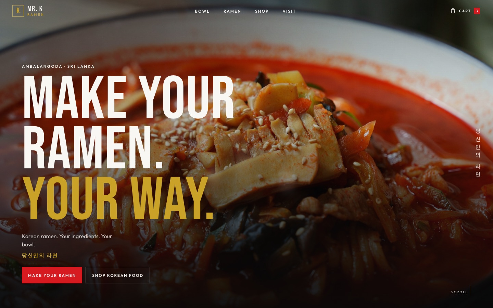
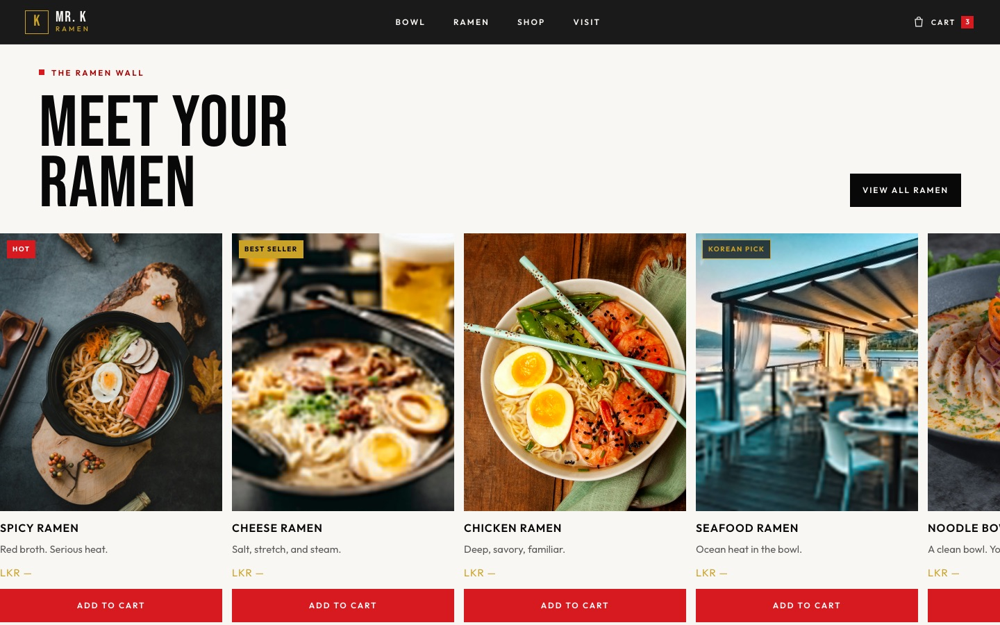
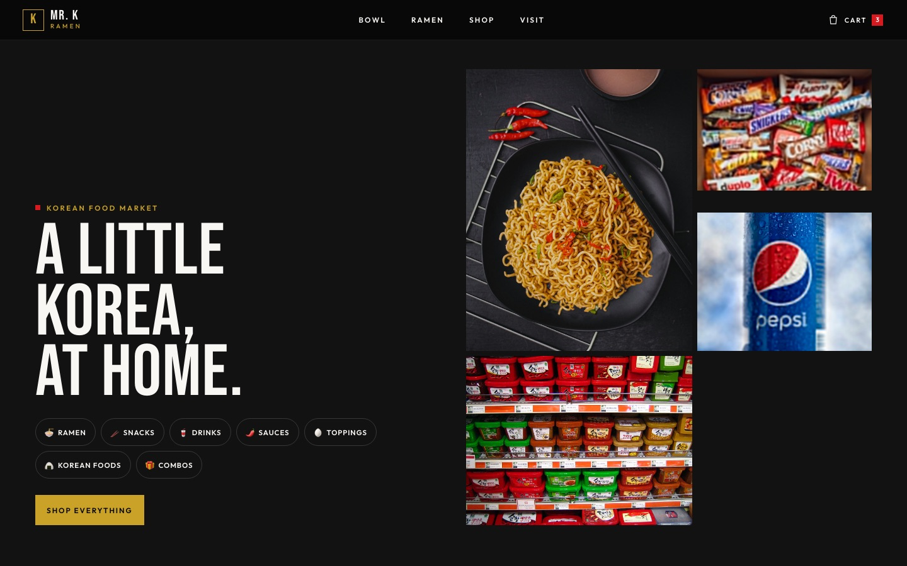
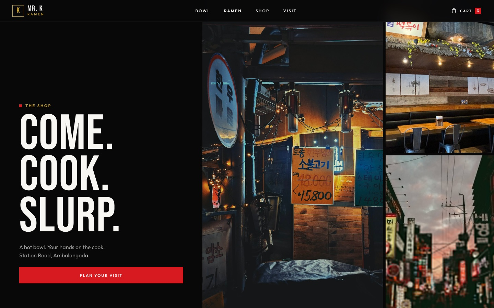
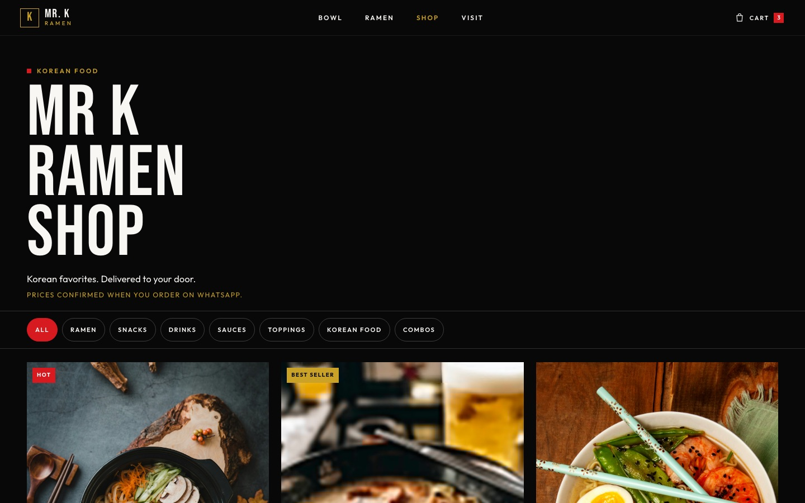
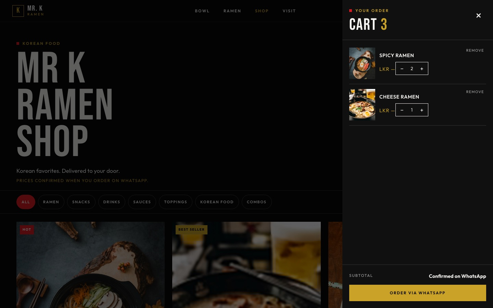
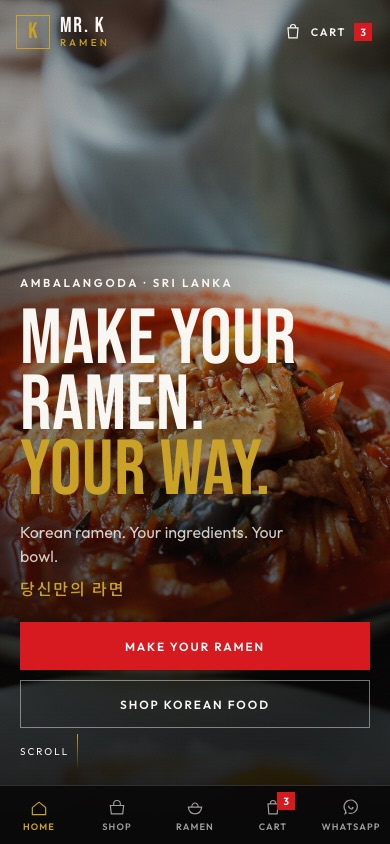
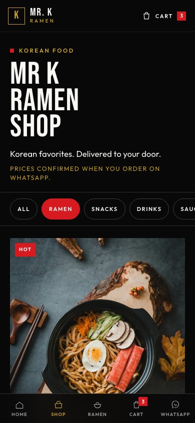

# 🍜 Mr. K Ramen

**Make your ramen. Your way.** — 당신만의 라면

The website for **Mr. K Ramen**, a self-cook Korean ramen shop on Station Road, Ambalangoda, Sri Lanka.
Visitors can explore the build-your-own-bowl concept, browse a Korean food shelf, add items to a cart,
and send the order straight to the shop on **WhatsApp**. No backend, no payments, no accounts.



---

## ✨ What's inside

| Feature | Description |
| --- | --- |
| **Landing page** (`/`) | A long, scroll-driven page: hero with parallax and steam, the "Build your bowl" toppings, how it works, the ramen wall, Korean food market, the shop experience, reviews, map and hours, feed, and a closing call to action. |
| **Shop** (`/shop`) | A product grid filtered by category (`/shop?cat=ramen`, `snacks`, `drinks`, `sauces`, `toppings`, `foods`, `combos`) with quantity steppers. |
| **Cart drawer** | Slide-in cart that is saved in `localStorage`, so it survives page reloads. Opens from the header, mobile tab bar, or the "added" toast. |
| **WhatsApp ordering** | Builds a pre-filled message (`Hi Mr K Ramen! 🍜 … • Spicy Ramen × 2 …`) and opens `wa.me/<number>`. |
| **Mobile tab bar** | Bottom navigation on phones: Home · Shop · Ramen · Cart · WhatsApp. |
| **Google Maps** | Embedded map plus "Get directions" and "Visit us" links built from the shop's coordinates. |
| **Polish** | One-time intro loader per session, scroll-reveal animations, `prefers-reduced-motion` support, skip link, ARIA labels, Korean typography (Noto Sans KR). |

### Screenshots

| Ramen wall | Korean food market |
| --- | --- |
|  |  |

| The shop experience | Shop page |
| --- | --- |
|  |  |

**Cart and WhatsApp checkout**



**Mobile**

<p>
  
  &nbsp;
  
</p>

---

## 🛠 Tech stack

- **[React 19](https://react.dev)**: function components, hooks, and Context for the cart
- **[Vite 8](https://vite.dev)** with `@vitejs/plugin-react`: dev server and build
- **[Oxlint](https://oxc.rs)**: linting
- **Plain CSS**: no UI framework; design tokens and layout live in `src/styles/`
- **Google Fonts**: Bebas Neue (headlines), Outfit (body), Noto Sans KR (Korean)

There are no runtime dependencies besides React and React DOM. Routing is a small custom
`history.pushState` router in `App.jsx`, so there is no React Router.

---

## 🚀 Getting started

Requires **Node.js 20+**.

```bash
npm install       # install dependencies
npm run dev       # start the dev server → http://localhost:5173
npm run build     # production build → dist/
npm run preview   # serve the production build locally
npm run lint      # run oxlint
```

---

## 📁 Project structure

```
Mr.K Ramen/
├── index.html                 # HTML shell, SEO/OG meta, fonts, hero preload
├── vite.config.js
├── public/
│   ├── favicon.svg
│   └── images/                # all food, ingredient and atmosphere photos
├── docs/screenshots/          # images used in this README
└── src/
    ├── main.jsx               # entry point, imports global styles
    ├── App.jsx                # app shell, mini router, intro loader, toast
    ├── pages/
    │   ├── Home.jsx           # landing page sections
    │   └── Shop.jsx           # category-filtered product grid
    ├── components/
    │   ├── Header.jsx         # top nav and cart button (turns solid on scroll)
    │   ├── MobileNav.jsx      # bottom tab bar for phones
    │   ├── CartDrawer.jsx     # slide-in cart and WhatsApp order button
    │   ├── ProductCard.jsx    # product tile with badge, price, qty, add to cart
    │   ├── Footer.jsx
    │   └── Logo.jsx
    ├── context/
    │   └── CartContext.jsx    # cart state, localStorage persistence, toast
    ├── hooks/
    │   └── useReveal.js       # IntersectionObserver scroll-reveal
    ├── lib/
    │   └── whatsapp.js        # money formatting, order message, wa.me link
    ├── data/
    │   ├── site.js            # ✏️ business settings and page content
    │   └── products.js        # ✏️ product shelf
    └── styles/
        ├── global.css         # tokens, header, buttons, cart, tab bar
        ├── home.css           # landing page sections
        └── shop.css           # shop page
```

---

## ✏️ Editing content (no layout changes needed)

Almost everything a shop owner would change lives in two files.

### `src/data/site.js`: business settings

| Field | What it controls |
| --- | --- |
| `name`, `logo`, `tagline`, `locationLabel` | Branding text |
| `address` (`street`, `city`, `lat`, `lng`) | Address block and Google Maps embed/links |
| `phoneDisplay` | Phone number shown on the page |
| `whatsappNumber` | **Digits only, with country code, no `+`** (e.g. `94761919895`). Leave empty to hide WhatsApp buttons. |
| `hoursSummary`, `hoursTime`, `hours[]` | Opening hours. A day-by-day list appears only if days differ. |
| `rating`, `reviews[]` | Google rating line and review cards |
| `instagramUrl`, `instagramHandle` | The "Follow" button appears once these are filled in |
| `openCartOnAdd` | `true` opens the cart drawer every time something is added |
| `ingredients`, `buildSteps`, `howSteps` | "Build your bowl" and "How it works" content |
| `visitPhotos`, `socialPhotos` | Atmosphere and feed images |

### `src/data/products.js`: the shelf

The shelf has 20 placeholder products: 6 ramen, 4 toppings, and 2 each of snacks, drinks, sauces,
Korean foods and combos.

```js
{
  id: "spicy-ramen",          // unique, used as the cart key
  name: "Spicy Ramen",
  description: "Red broth. Serious heat.",
  price: null,                // number in LKR, or null → shows "LKR —"
  category: "ramen",          // ramen | snacks | drinks | sauces | toppings | foods | combos
  badge: "HOT",               // optional: HOT, BEST SELLER, KOREAN PICK, …
  image: "/images/spicy.jpg", // file in public/images/
  featured: true,             // also shown in "From the shelf" on the home page
}
```

> While a product's `price` is `null`, the cart shows **"Confirmed on WhatsApp"** instead of a total,
> and the WhatsApp message leaves the total out.

---

## 🛒 How ordering works

1. A customer taps **Add to cart** on a product card. Items are stored under `mrk-ramen-cart` in `localStorage`.
2. A toast confirms it, and the cart count updates in the header and the mobile tab bar.
3. In the cart drawer they change quantities or remove items.
4. **Order via WhatsApp** opens `https://wa.me/<whatsappNumber>?text=…` with a message like this:

```
Hi Mr K Ramen! 🍜

I'd like to order:

• Spicy Ramen × 2
• Cheese Ramen × 1

Please confirm availability and delivery details.
```

The shop confirms prices and delivery in the chat.

---

## 🖼 Images

All images live in `public/images/` and are referenced by absolute path (`/images/…`).
Most are atmospheric stock stand-ins. **Replace them with real Mr. K Ramen photos** by keeping
the same file names, or by updating the paths in `site.js` and `products.js`.

Three images come from Wikimedia Commons. If you keep them, keep these credits:

| File | Source | License |
| --- | --- | --- |
| `seoul2.jpg` | [Streets of Seoul](https://commons.wikimedia.org/wiki/File:Streets_of_Seoul_-_Flickr_-_Sergiy_Galyonkin.jpg), Sergiy Galyonkin | CC BY-SA 4.0 |
| `sauce.jpg` | [Gochujang by ayustety in Seoul](https://commons.wikimedia.org/wiki/File:Gochujang_by_ayustety_in_Seoul.jpg), ayustety | CC BY-SA 2.0 |
| `interior.jpg` | [Jincook Korean Restaurant interior](https://commons.wikimedia.org/wiki/File:Jincook_Korean_Restaurant_(Glendale,_California)_interior.JPG) | CC0 |

---

## 🌐 Deployment

`npm run build` outputs a static site to `dist/`, which you can host on Netlify, Vercel,
GitHub Pages, Cloudflare Pages, or any static host.

> **Important:** `/shop` is a client-side route. Configure your host to serve `index.html` for unknown paths:
>
> - **Netlify**: add `public/_redirects` containing `/*  /index.html  200`
> - **Vercel**: add a rewrite of `/(.*)` → `/index.html` in `vercel.json`
> - **GitHub Pages**: copy `dist/index.html` to `dist/404.html` after building

---

## 📍 Visit

**Mr. K Ramen**, Station Road, Ambalangoda, Sri Lanka
🕙 Open daily, 10:00 AM – 10:00 PM · 📞 +94 76 191 9895
